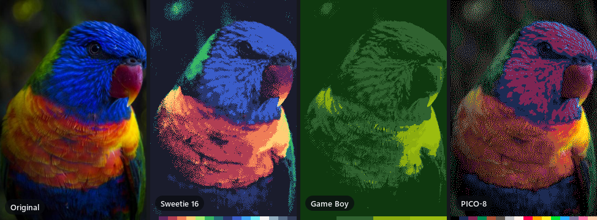
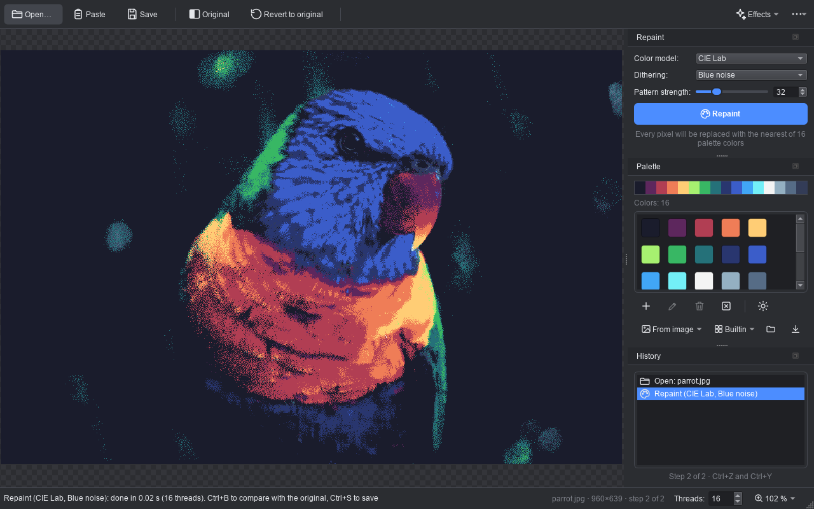
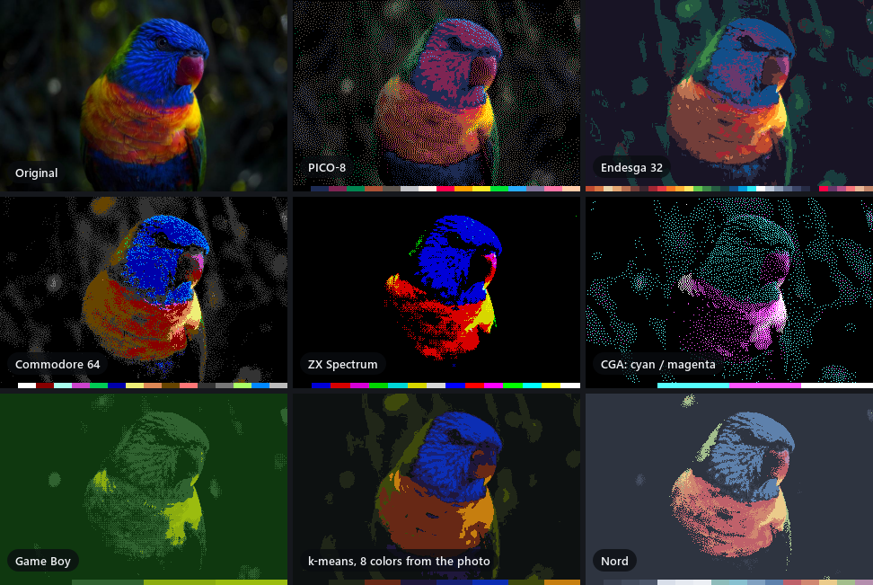
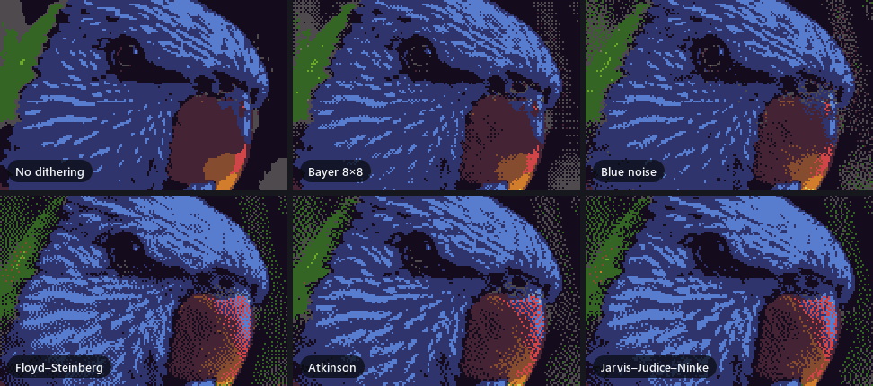
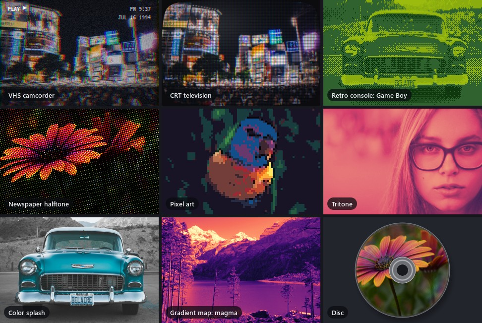

<p align="center">
  
</p>

<h1 align="center">Kolorit</h1>

<p align="center">
  <b>Repaint any image into any palette, then give it a retro soul.</b><br>
  A fast desktop app for palette art, dithering and analog-era effects.
</p>

<p align="center">
  <a href="https://github.com/Kalikoff/Kolorit/actions/workflows/build.yml"></a>
  <a href="LICENSE"></a>
  
  
  
</p>

<p align="center">
  
</p>

Kolorit takes a photo and rebuilds it from a limited set of colors: a Game Boy's four greens,
the sixteen of PICO-8, the palette of your brand, or colors lifted from another picture.
Every pixel is matched to its nearest palette color in the color space you choose, with
dithering to fake the shades in between. On top of that sit eighteen effects, from gradient
maps and CMYK halftone to a CRT screen and a VHS camcorder with a date stamp.

It is built for play: settings preview live on the full image, every step lands in a
Photoshop-style history, and a whole folder can be repainted from the command line.

<p align="center">
  
</p>

## One photo, endless palettes

<p align="center">
  
</p>

- **39 built-in palettes** in five families: retro hardware (NES, ZX Spectrum, Commodore 64,
  CGA, EGA, Game Boy and more), pixel-art sets (PICO-8, DawnBringer, Sweetie 16, Endesga 32),
  UI themes (Solarized, Nord, Dracula, Catppuccin, Material, Tailwind), perceptual ramps
  (viridis, magma, turbo) and photographic tonings (sepia, cyanotype, platinum).
- **Palettes from images.** Pull the characteristic colors out of a photo with k-means,
  average a grid of cells, collect every unique color, or borrow the palette of a reference
  image to give your shot its look.
- **Palette generator** for grayscale steps that look even to the eye, single-hue ramps,
  blends between two or three colors, per-channel levels and hue wheels.
- **Edit freely**: add, recolor, drag to reorder, sort by luminance, hue or as a smooth
  gradient, reduce a 213-color palette to the 16 that matter, merge palettes.
  Palettes are plain N×1 PNG files.

## Dithering that holds up up close

<p align="center">
  
</p>

Ten methods: ordered Bayer 2×2, 4×4 and 8×8, a **blue-noise** texture that gives an even grain
without the grid, and five error-diffusion kernels (Floyd–Steinberg, Atkinson, Sierra, Stucki,
Jarvis–Judice–Ninke). Diffusion runs in serpentine order so errors don't drift into slanted
trails, and each color channel gets its own phase of the ordered pattern, which renders
in-between hues, not just in-between brightness.

## Effects

<p align="center">
  
</p>

| | |
|---|---|
| **Retro** | VHS camcorder with tracking noise, color bleed and a `PLAY ▶` date stamp · CRT television with a curved screen, phosphor mask and scanlines · Game Boy, NES and ZX Spectrum with their real resolution and color limits · pixel art with outlines |
| **Print and tone** | CMYK halftone with offset-press screen angles · duotone and tritone · gradient maps · color splash · a CD/DVD disc mock-up |
| **Grading** | Levels with per-channel black points · brightness, contrast, saturation · 3D LUTs in the `.cube` format, and any Kolorit result exported as a `.cube` for DaVinci Resolve or Premiere |
| **Cleanup** | Noise and JPEG artifact removal that keeps edges · posterize · pixelate · grayscale, sepia, invert |

## Made for experimenting

- **Live preview.** Effect dialogs stay out of the way: zoom and pan the picture while you
  drag sliders. A quick preview appears instantly, the full-resolution frame follows a
  moment later, and *Apply* reuses it without recomputing.
- **History like Photoshop.** Every operation becomes a step you can click back to. Steps
  store the operation, not a copy of the image, so 64 steps of a 12 MP photo cost two
  images of memory.
- **Presets** for effect settings, one click away.
- **Compare** with the original at any moment (`Ctrl+B`).
- **Five color models** decide what "nearest color" means: RGB, HSL, HSV, XYZ and
  perceptual CIE Lab. The [guide](docs/GUIDE.md#color-models) explains which suits which photo.
- **Every core.** Processing runs in parallel over image rows, with progress and `Esc` to cancel.
  A 1-megapixel repaint takes a few milliseconds.
- **Color managed.** Display P3 and Adobe RGB photos are converted to sRGB on open.
- **English and Russian** interface, picked from the system language or in the menu.

## Batch processing

`kolorit-cli` runs the same repaint over files or whole folders:

```bash
kolorit-cli --palette "Sweetie 16" --model lab --dither floyd --out Results Photos
```

Use a built-in palette by name (`kolorit-cli --list-palettes`) or any N×1 PNG. See
`kolorit-cli --help` for models, dithering methods and output formats.

## Getting started

**Download** the latest build from
[Releases](https://github.com/Kalikoff/Kolorit/releases/latest):

- **Windows x64**: unzip the archive and run `bin\Kolorit.exe`, no installation needed.
- **macOS 13+** (Apple Silicon and Intel): open the `.dmg` and drag Kolorit to Applications.
  The app is not notarized, so allow the first launch in System Settings → Privacy & Security
  (*Open Anyway*).

Kolorit is written in C++20 with Qt 6.10 and builds with CMake 3.21+ on Windows and macOS.

```bat
:: Windows: tell CMake where Qt lives
set QTDIR=C:\Qt\6.10.2\msvc2022_64

cmake --preset vs2022
cmake --build --preset vs2022-release
ctest --preset vs2022-release
```

```bash
# macOS: Xcode Command Line Tools, CMake and Ninja
export QTDIR=~/Qt/6.10.2/macos

cmake --preset ninja-release
cmake --build --preset ninja-release
ctest --preset ninja-release
```

The app lands in `build/<preset>/bin/` (`Kolorit.exe` or `Kolorit.app`). To get a
self-contained copy with the Qt libraries (a folder on Windows, a signed `Kolorit.app` on macOS):

```bat
cmake --install build/vs2022 --config Release --prefix %CD%\dist
```

```bash
cmake --install build/ninja-release --prefix "$PWD/dist"
```

A preset for Visual Studio 2026 is included too. The [guide](docs/GUIDE.md) covers
building, the architecture and every feature in detail.

## Documentation

- [User guide](docs/GUIDE.md): color models, palettes, dithering, every effect, the interface,
  the command line, building and the architecture.
- [Руководство на русском](docs/GUIDE.ru.md)

## Made with AI

Kolorit was developed with the help of AI.

## Credits

- Demo photos from [StockSnap](https://stocksnap.io), released under CC0: lorikeet by
  Stefan Stefancik, Shibuya crossing by Negative Space, mountain lake by Aukje Leermakers,
  flower by Macro Mama, vintage car by Kace Rodriguez, portrait by Dmitriy Goncharov.
  All demo images are generated from them by `tools/readme_images.cpp`.
- The VHS overlay uses [VT323](https://fonts.google.com/specimen/VT323) by Peter Hull,
  under the [SIL Open Font License](resources/fonts/VT323-OFL.txt).
- Pixel-art palettes by their authors: PICO-8 by Lexaloffle, DawnBringer 16 and 32 by
  DawnBringer, Sweetie 16 by GrafxKid, Endesga 32 by ENDESGA. The viridis family comes from
  matplotlib (CC0), turbo from Google (Apache 2.0). Theme palettes belong to their projects.

## License

Kolorit is released under the [MIT License](LICENSE).
