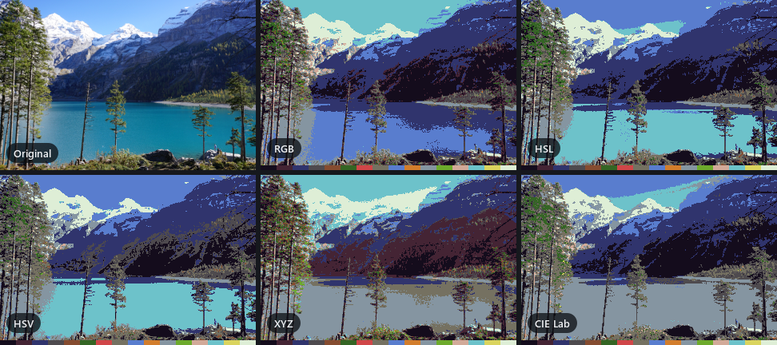

# Kolorit user guide

This guide covers everything Kolorit does and how it does it. For a quick introduction,
see the [README](../README.md). A Russian version is in [GUIDE.ru.md](GUIDE.ru.md).

- [Quick tour](#quick-tour)
- [Color models](#color-models)
- [Dithering](#dithering)
- [Palettes](#palettes)
- [Effects](#effects)
- [Working with images](#working-with-images)
- [Interface](#interface)
- [Command line](#command-line)
- [Building and testing](#building-and-testing)
- [Architecture](#architecture)

## Quick tour

1. **Open an image**: `Ctrl+O`, paste from the clipboard with `Ctrl+V`, drop a file onto the
   window, or pass a path on the command line.
2. **Choose a palette** on the *Palette* panel: *Builtin* opens the palette library,
   *From image* builds one from the open photo, the folder button loads a PNG.
3. **Repaint** (`Ctrl+R`) on the *Repaint* panel, after picking a color model and a dithering method.
4. **Add effects** from the *Effects* menu. Each one opens a dialog with a live preview.
5. **Compare** with the original (`Ctrl+B`), step back through the *History* panel, and
   **save** the result (`Ctrl+S`) as PNG, JPEG, BMP or WebP.

## Color models

Repainting replaces every pixel with the palette color closest to it. "Closest" depends on
the space in which the distance is measured, and that choice matters more the less the
palette resembles the photo.

<p align="center">
  
</p>

| Model | How colors are compared | When to use it |
|---|---|---|
| **RGB** | Euclidean distance between channels | Holds luminance most evenly. The best choice for palettes of pure colors (ZX Spectrum) and for tinted monochrome palettes like the Game Boy. It overrates blue: blue contributes a third of the distance while giving only 7 % of the luminance. |
| **HSL** | A bicone: hue is the angle, chroma the radius, lightness the height | Chroma weighs twice as much as lightness, so hues are kept more faithfully while tones get simplified more. Good for colorful palettes, unsuitable for grayscale palettes. |
| **HSV** | A cone: the radius is saturation × value, the height is the largest channel | Like HSL, but "value" is max(R, G, B), so a saturated blue sits as high as white and shadows get lifted. Not for gray palettes. |
| **XYZ** | CIE XYZ (D65), linear light | A step in the highlights weighs about eight times more than the same step in the shadows, so highlights stay detailed and shadows collapse. More an artistic device than accuracy. |
| **CIE Lab** | Perceptually uniform space, ΔE76 distance | Usually the best result for photos: distance matches the visible difference between colors, and the palette is used more fully. On tinted monochrome palettes (Game Boy) it loses the light tones; use RGB there. |

**Rules of thumb**

- Photos and a palette with plenty of hues (pixel-art sets, UI themes, k-means): **CIE Lab**.
- A few pure hardware colors (ZX Spectrum, CGA) or a monochrome ramp (Game Boy): **RGB**.
- A palette taken from the photo itself (k-means): the model barely matters; RGB, HSL and Lab
  differ by a few percent, only XYZ lags behind.
- Want bold, poster-like color at the cost of tonal detail: **HSL**.

## Dithering

Dithering mixes palette colors in small patterns so the eye sees the shades in between.

<p align="center">
  
</p>

| Method | Character |
|---|---|
| None | Every pixel simply takes the nearest color. Flat areas, visible banding. |
| Bayer 2×2, 4×4, 8×8 | An ordered pattern: the retro look of old screens. The larger the matrix, the more halftones and the finer the grid. |
| Blue noise | Ordered, but without a grid: the thresholds are placed by the void-and-cluster algorithm so the pattern dissolves into an even grain. The best-looking ordered method, and just as fast. |
| Floyd–Steinberg | Error diffusion: smooth transitions with few colors. |
| Atkinson | Spreads only 6/8 of the error: a more contrasty, crisp picture, fine transitions are not smeared. The look of the classic Macintosh. |
| Sierra | A wide diffusion kernel: softer than Floyd–Steinberg, fewer visible trails. |
| Stucki | An even wider kernel: the smoothest transitions, a bit slower. |
| Jarvis–Judice–Ninke | The widest kernel: the softest and the slowest. |

The *pattern strength* slider sets the amplitude of ordered dithering in RGB units (0 to 128).

A few details make the results cleaner than a textbook implementation:

- **Per-channel phase.** In ordered dithering each color channel gets its own phase of the
  pattern, so dithering renders in-between hues, not only in-between brightness.
- **Serpentine scan.** Error diffusion goes left to right on even rows and right to left on
  odd rows, mirroring the kernel on the way back. A one-way scan drifts the error to the right
  and leaves slanted trails.
- **Error clamp.** The accumulated error is limited to ±96 per channel. When a palette lacks a
  color entirely (a color photo in a gray palette), the error otherwise grows without bound
  and wrecks the picture.

## Palettes

A palette is an ordered list of opaque colors. On disk it is an N×1 PNG where every pixel is
one color; any other image can be loaded too, and all its unique colors are taken.

### Built-in palettes

The *Builtin* button on the Palette panel groups them into five sections:

- **Ramps and gradients.** Colors run strictly from shadows to highlights, which is what a
  gradient map and a duotone need, because there the order of the palette is the shape of the
  gradient. The perceptually uniform colormaps viridis, magma, inferno, plasma, cividis
  (designed for deuteranopia) and turbo, plus the classic photographic tonings: sepia,
  cyanotype, platinum print and selenium toning.
- **Retro platforms.** NES / Famicom, ZX Spectrum, Game Boy and Game Boy Pocket, Commodore 64,
  IBM CGA (16 colors plus the two iconic four-color sets of mode 4), IBM EGA (64) and
  Amstrad CPC (27), MSX 1 / TMS9918, Macintosh System. Values come from widely accepted
  reconstructions: for most machines there are no "true" numbers, since the color was born
  in the analog video path.
- **Pixel art.** PICO-8, DawnBringer 16 and 32, Sweetie 16, Endesga 32. These were assembled
  by artists so that colors go together and every hue has shadows and highlights, so on photos
  they look noticeably more coherent than hardware palettes of the same size. Measured with
  ΔE2000 on a test image, Sweetie 16 (10.63) beats not only CGA and Macintosh at the same
  16 colors (16.06 and 16.38) but also the NES at 54 colors (13.13) and EGA at 64 (11.69);
  Endesga 32 reaches 8.77.
- **UI themes.** Solarized, Nord, Gruvbox, Dracula, Catppuccin Mocha, Material Design
  (the 500 tones) and Tailwind CSS (the 500 shades): fit a photo to a brand style or the look
  of a website.
- **Apps and print.** Gartic Phone, MS Paint, RAL Classic (213 colors), web-safe (216) and a
  360-hue rainbow.

### Creating palettes

*Builtin → Create palette…* opens one dialog for five generators; the strip at the bottom
shows the result as you type.

- **Grayscale**: 2 to 256 levels. *Visually even steps* spaces them evenly in lightness L*
  instead of in bytes, which makes the most visible step 12 to 17 % shorter.
- **Tint of one color**: a ramp of one hue through the whole tonal range. Saturation falls off
  towards black and white, so unlike the hardware Game Boy palette it never collapses into two colors.
- **Ramp between colors**: two or three colors, interpolated in CIE Lab.
- **Levels per channel**: all combinations of even per-channel levels. 3 levels give the
  Amstrad CPC palette, 4 give EGA, 6 give web-safe.
- **Hue wheel**: hues around the circle at equal lightness and chroma, so none of them sticks out.

*From image* builds a palette from the open photo:

- **Characteristic colors (k-means)**: the k colors that best describe the image. Clustering
  happens in CIE Lab, so the colors spread the way the eye tells them apart; in RGB clusters
  skew towards blue. k-means++ initialization, parallel assignment, up to 2 million samples.
- **Average colors on a grid (chunks)**: the image is split into X×Y cells and each cell
  contributes its average color, with a live preview.
- **All unique colors** (up to 256).
- **From another image**: k-means on a reference file, applied to the open photo. This is the
  "make this shot in the look of that one" trick.

### Editing

The Palette panel shows a preview strip and a grid of swatches. Add a color with `+`, change
one with a double-click, remove with `Delete`, drag to reorder, sort by luminance or hue.
The `⋯` button holds the operations on the whole palette:

- **Order as gradient** puts the closest colors next to each other (a greedy path through
  CIE Lab starting from the darkest color). Useful for gradient maps and duotones; on a reduced
  RAL palette the sum of steps drops from 1011 to 602.
- **Reduce to N colors** runs k-means on the palette itself: RAL Classic's 213 colors become a
  working set of 16, with an error of 12.1 against 14.8 for an even selection.
- **Add palette from file** merges another palette, skipping duplicates.

The current palette is remembered between sessions.

## Effects

<p align="center">
  
</p>

All effects except the three one-click ones (invert, grayscale, sepia) open a dialog with a
live preview. Most dialogs can save their settings as named presets.

**Tone and color**

- **Color correction**: brightness, contrast and saturation.
- **Levels**: black and white points, midtone gamma, output range, and separate black-point
  shifts per channel to remove a color cast in the shadows.
- **Color splash**: the chosen hue range stays in color, the rest turns gray. The range wraps
  around the hue circle, so red across 0°/360° is not split; a saturation threshold keeps
  nearly gray pixels out.
- **Gradient map**: pixel luminance becomes a position along the current palette (first color
  for shadows, last for highlights). Smooth or stepped, reversible, with a midtone balance and
  a strength slider. Two or three colors give a duotone, a colormap gives a heat map.
- **Duotone / tritone**: two colors for shadows and highlights, optionally a third for midtones.
- **Color table (.cube)**: applies a 3D LUT from DaVinci Resolve, Premiere or Photoshop with
  trilinear interpolation (1D tables are read too). **Save .cube from result** does the opposite:
  it runs the last operation over a 33³ color cube and writes it as a LUT, so a palette repaint
  can travel into a video editor.

**Retro**

- **VHS camcorder**: chromatic aberration with a choice of filter for the left and right layers,
  color bleed (chroma blurred while luminance stays sharp, as on analog video), smooth line
  jitter with rare tears, a tracking band, scanlines, grain, vignette, color correction and an
  on-screen display: 12-hour time (`PM 1:02`), date (`FEB 21 2023`), a line of your own and a
  `PLAY ▶`, `● REC` or `PAUSE` indicator in the corner, size and color of your choice. The text
  has its own aberration. A seed makes the noise reproducible.
- **CRT television**: a curved picture tube with rounded corners and a bezel, color
  misconvergence, glow of bright areas, a phosphor mask (aperture grille, shadow mask or slot
  mask), scanlines, vignette, a reflection on the glass and a brightness gain.
- **Retro console**: Game Boy (green or Pocket gray), NES / Famicom, ZX Spectrum. The image is
  downscaled to the console resolution, quantized to its hardware palette with dithering, and
  the real limits apply: the Game Boy sees only 4 levels of luminance, the NES allows 4 colors
  per 16×16 block, the Spectrum two colors of the same brightness per 8×8 cell (the famous
  attribute clash). Then it is scaled back up with crisp pixels, optionally by an integer
  factor with borders. Chain it with the CRT effect for the full old-TV look.
- **Pixel art**: big pixels, colors reduced to levels per channel or to the current palette in
  the chosen color model, and dark outlines drawn along the darker side of contrasting edges.
  The palette and the model can be changed on the panels while the dialog is open.
- **Disc**: the picture is cropped to a circle and printed on a CD/DVD with a hole and a hub
  (clear plastic, a dark mechanism with an accent ring matching the image, or print to the
  center), a clear rim, diffraction rainbow, glossy highlight, tracks and a soft shadow.
  The background is transparent, so save it as PNG or WebP.

**Print and cleanup**

- **Halftone**: the image becomes dots of varying size. With CMYK separation each ink gets its
  own screen angle (15°, 75°, 0° and 45°) as in offset printing, so the dots form rosettes and
  produce no moiré. A single black ink and light-on-dark printing are available too.
- **Remove artifacts**: a bilateral filter smooths noise, grain and JPEG blocking without
  blurring edges; an optional median filter removes speckles.
- **Posterize**, **Pixelate**, **Grayscale**, **Sepia**, **Invert**.

## Working with images

- **Color profiles.** If a photo carries an embedded profile (Display P3 from phones, Adobe RGB
  from cameras), its colors are converted to sRGB when it opens, and the status bar says from
  which profile. All processing treats colors as sRGB, so without the conversion the picture
  would shift before any repainting.
- **History.** The History panel lists every step from the opened file down. Each finished
  operation becomes a step and the current image, so chains build themselves. Clicking a row
  returns to that step; steps below the current one are dimmed: they are still reachable, but
  disappear as soon as a new operation is applied on top. `Ctrl+Z` steps back, `Ctrl+Y` or
  `Ctrl+Shift+Z` forward, `F12` returns to the original.

  Steps store the operation rather than a copy of the image; any step is recomputed by running
  the chain from the original. History therefore costs almost no memory and holds 64 steps.
  Going back takes a recomputation, which runs in the background with progress and `Esc` to
  cancel: a chain of ten operations takes 35 ms at 1.1 megapixels and about 0.3 s at
  9.7 megapixels. Going forward costs exactly one operation.
- **Saving**: PNG, JPEG, BMP or WebP. Formats without transparency get a flattened image.
- **Working folders.** `Images/`, `Results/` and `Palette/` are created next to the executable
  (on macOS in `~/Documents/Kolorit`) as default locations for the file dialogs.

## Interface

- **Toolbar**: open, paste, save | original (compare), revert to original | cancel (while
  processing) … *Effects* and `⋯` (theme, language, panels, about, exit). There is no menu
  bar; every action lives in exactly one place.
- **Panels**: *Repaint* (color model and dithering with explanations, the main button, and a
  note on why it is disabled when it is), *Palette* and *History*. Panels can be moved,
  detached and hidden.
- **Live preview.** Effect dialogs are modeless: while you tune them, the main window stays
  alive, so you can zoom with the wheel, pan, fit to window (`Ctrl+0`), view 1:1 (`Ctrl+1`) or
  compare with the original (`Ctrl+B`). Every change produces an instant frame from a
  downscaled copy; after a short pause the same effect is computed at full resolution so that
  zooming in shows real detail. *Apply* reuses the full-size frame when it is ready.
- **Presets.** Effect dialogs have a single row at the top: a list of saved presets,
  *Save…* and *Delete*.
- **Themes**: dark (the default), light and system, switched on the fly in `⋯ → Theme`.
- **Language**: English or Russian, following the system language by default. `⋯ → Language`
  switches it and offers a restart.
- **Updates**: at startup Kolorit asks GitHub in the background whether a newer release is out
  and, if so, offers to download it (the file opens in the browser) or to skip that version.
  Nothing is shown when there is no news or no network. `⋯ → Check for updates…` checks on demand,
  and `⋯ → Check for updates at startup` turns the automatic check off.
- **Threads**: the status bar has a spin box for the number of worker threads (by default,
  the number of CPU cores) and a zoom button with quick values.

### Keyboard shortcuts

| Action | Shortcut |
|---|---|
| Open image | `Ctrl+O` |
| Paste image | `Ctrl+V` |
| Save result | `Ctrl+S` |
| Load palette | `Ctrl+L` |
| Repaint into palette | `Ctrl+R` |
| Cancel the running operation | `Esc` |
| Show the original | `Ctrl+B` |
| Step back / forward | `Ctrl+Z` / `Ctrl+Y`, `Ctrl+Shift+Z` |
| Revert to original | `F12` |
| Fit to window / actual size | `Ctrl+0` / `Ctrl+1` |
| Zoom in / out | `Ctrl++` / `Ctrl+-`, mouse wheel |
| Remove palette colors | `Delete` |

## Command line

`kolorit-cli` repaints files or whole folders without opening a window:

```bash
kolorit-cli --palette "Sweetie 16" --model lab --dither floyd --out Results Photos
```

| Option | Values |
|---|---|
| `--palette` | A path to an N×1 PNG (or any image) or a built-in palette name, case-insensitive |
| `--out` | Output folder, created if needed |
| `--model` | `rgb`, `hsl`, `hsv`, `xyz`, `lab` (default `lab`) |
| `--dither` | `none`, `bayer2`, `bayer4`, `bayer8`, `bluenoise`, `floyd`, `atkinson`, `sierra`, `stucki`, `jarvis` (default `none`) |
| `--strength` | Ordered dithering strength, 0 to 128 (default 32) |
| `--format` | `png`, `jpg`, `webp`, `bmp` (default `png`) |
| `--list-palettes` | Print the built-in palettes and exit |

Inputs can be files and folders; folders are expanded to the images they contain. Files with
the same name from different folders get a numeric suffix instead of overwriting each other.
The tool speaks English regardless of the system language, so scripts behave the same
everywhere. The exit code is 0 on success, 1 if some files failed and 2 for invalid arguments.

On Windows the command-line tool is a separate executable because `Kolorit.exe` is a GUI
application: it has no console, so its output would go nowhere and the shell would not wait
for it. On macOS it lives inside the app bundle and shares its Qt libraries:
`/Applications/Kolorit.app/Contents/MacOS/kolorit-cli`.

## Building and testing

Ready-made builds for Windows and macOS are on the
[Releases](https://github.com/Kalikoff/Kolorit/releases) page. The Build workflow builds and
tests both platforms on every push; pushing a tag such as `v1.0.1` also publishes a release with
the zipped Windows build and the macOS disk image.

Requirements: CMake 3.21 or newer, Qt 6.10 or newer (Core, Gui, Widgets, Concurrent, Svg, Network,
LinguistTools; the Image Formats add-on for WebP) and a C++20 compiler (MSVC 2022+, GCC 11+,
Clang 14+). Kolorit is built and tested on Windows and macOS 13+.

The presets find Qt through the `QTDIR` environment variable. Alternatively, pass
`-DCMAKE_PREFIX_PATH=<Qt path>` or add your own presets in `CMakeUserPresets.json`.

**Windows**, Visual Studio 2022 or 2026:

```bat
set QTDIR=C:\Qt\6.10.2\msvc2022_64
cmake --preset vs2022
cmake --build --preset vs2022-release
```

Ninja, from a *Developer Command Prompt for VS*:

```bat
cmake --preset ninja-release
cmake --build --preset ninja-release
```

**macOS** needs the Xcode Command Line Tools (`xcode-select --install`), CMake and Ninja:

```bash
export QTDIR=~/Qt/6.10.2/macos
cmake --preset ninja-release
cmake --build --preset ninja-release
```

Add `-DCMAKE_OSX_ARCHITECTURES="arm64;x86_64"` to the configure step for a universal build that
runs on both Apple Silicon and Intel; the release build is made this way.

The executables land in `build/<preset>/bin/`. On Windows, to run them from there, `<Qt>/bin`
must be on `PATH`; or install a self-contained copy with the Qt libraries, plugins and
translations (the prefix must be an absolute path):

```bat
cmake --install build/vs2022 --config Release --prefix %CD%\dist
```

On macOS the install step produces `dist/Kolorit.app` with the Qt frameworks, `kolorit-cli`
inside the bundle and an ad hoc signature, so it runs on Apple Silicon:

```bash
cmake --install build/ninja-release --prefix "$PWD/dist"
```

**Tests**

```bat
ctest --preset vs2022-release
```

```bash
ctest --preset ninja-release
```

- `kolorit_selftest <image|-> <folder>` runs every core operation on one thread and on all of
  them, checks that the results are identical, prints timings and saves PNG files.
- `kolorit_uitest <image|-> <folder>` creates the main window and every dialog offscreen,
  repaints, applies effects, walks the history, checks the Russian translation and saves
  snapshots of the widgets.

Passing `-` instead of an image makes the tests generate a synthetic one (`tests/TestImage.h`),
so they need no external files.

**Translations.** English is the source language. `translations/kolorit_ru.ts` holds the
Russian strings; it is compiled into the application at build time. After changing interface
strings, refresh it with `cmake --build <build> --target update_translations` and translate the
new entries in Qt Linguist. A new language needs a new `.ts` file in `CMakeLists.txt` and an
entry in `src/app/Language.cpp`.

**Demo images.** The pictures in this guide and in the README are rendered by
`tools/readme_images.cpp` from the photos in `docs/images/photos`:

```bat
cmake -B build/vs2022 -DKOLORIT_BUILD_TOOLS=ON
cmake --build build/vs2022 --config Release --target readme_images
```

## Architecture

### Multithreading

- Every operation is an `ImageOp`, a `std::function<QImage(const QImage&, QPromise<QImage>&)>`.
  Repainting, effects, palette building and history replay all have this type and are run by
  `ImageTaskRunner` on an orchestrator thread, so the interface never blocks.
- Inside an operation, `parallelRows()` spreads image rows over the global `QThreadPool`
  (`QtConcurrent::blockingMap` with adaptive block sizes). Rows are written straight into the
  output buffer (`RowWriter`) without `detach()` and without locks.
- Progress goes through `QPromise::setProgressValue`, cancellation through
  `QPromise::isCanceled()`, checked before every row.
- Randomness (VHS noise, k-means seeding) is deterministic, derived from a hash of the seed and
  the row number, so results do not depend on the number of threads. The self-test checks this.
- The nearest-color search is cached in 262,144 atomic cells (512 KB), keyed by the color
  reduced to 6 bits per channel and resolved for the center of each bucket, so repeated colors
  cost one memory read and the result does not depend on thread order. Coarsening changes the
  result by at most 0.02 ΔE2000 against a visibility threshold of about 1.
- Ordered dithering thresholds come from a precomputed table that stays in L1 cache.
- Error diffusion is inherently sequential; it runs in the background with progress and
  cancellation like everything else.

### Project layout

```
src/
  core/              processing core without QtWidgets
    ColorSpace         RGB, HSL, HSV, XYZ, Lab and YCbCr conversions, distances, ICC to sRGB
    Palette            the palette: N×1 PNG files, sorting, gradient order, merging
    BuiltinPalettes    the built-in palettes (arrays in code) and the palette generators
    ParallelFor        parallelRows(): a parallel pass over rows with progress and cancellation
    PixelOps           RowWriter, mapPixels(), row access without detach
    Random             a deterministic hash and a per-row xorshift generator
    ImageTask          the ImageOp operation type
    ImageTaskRunner    runs an operation asynchronously with progress, cancellation and a queue
  processing/
    PaletteMapper      repainting into a palette, the nearest-color cache, all dithering methods
    PaletteBuilder     palettes from images: chunks, k-means, unique colors, reduction
    Effects            tone, color, halftone, levels, pixel art, disc, .cube LUTs and more
    ConsoleEffect      Game Boy, NES and ZX Spectrum with their limits
    CrtEffect          the CRT television
    VhsEffect          VHS parameters, overlay rendering and the four-pass effect pipeline
  ui/
    Theme              dark, light and system themes, the style sheet, recolorable SVG icons
    MainWindow         toolbar, status bar, panels, history, running operations
    RepaintPanel       color model, dithering and the main button
    PalettePanel       the palette editor
    HistoryPanel       the list of history steps
    ImageView          the zoomable view; frames of any resolution in full-image coordinates
    PreviewDialog      the modeless dialog with a two-stage preview
    EffectParamsDialog, PaletteGeneratorDialog, ChunkPaletteDialog, KMeansPaletteDialog, VhsDialog
  app/
    BatchRunner        the command-line repaint
    Language           picking and loading the interface translation
    AppPaths           the working folders next to the executable
    Updates            the update check against the latest GitHub release
resources/           the VT323 font, the application icon and the SVG icon set
translations/        Qt translation sources (.ts)
tests/               selftest (core), uitest (interface, offscreen), a synthetic test image
tools/               the renderer of the documentation images
docs/                this guide and its images
```
